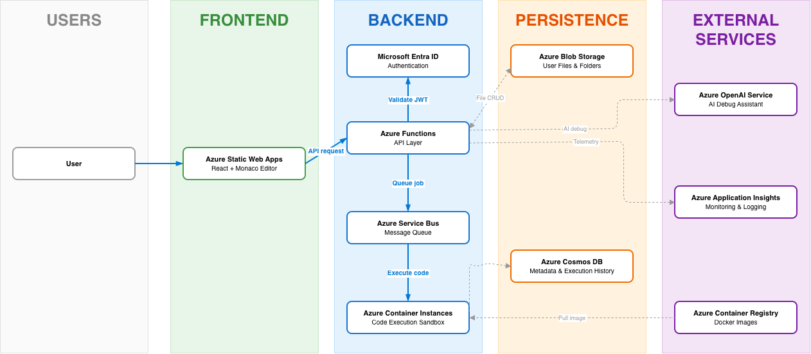

# Online Code Editor & Sandbox

Project for **Cloud Computing using Microsoft Azure** — BSc in Computer Science, University of Bucharest (Year 3, Semester 1).

---

## Overview

A browser-based code editor and execution sandbox that allows users to write, run, and manage multi-file projects in multiple languages, with integrated AI debugging. Code execution runs in isolated cloud containers so users don't need local compilers or runtimes installed.

---

## Functional Requirements

- **Authentication**: Sign-up, login, and session handling via **Microsoft Entra ID** with JWT bearer tokens.
- **Project Management**: Create, list, rename, and delete projects configured for specific languages (Python, C/C++, JavaScript, Java).
- **File Management**: Create, edit, rename, and delete files/folders within a virtual tree. In-browser editing powered by **Monaco Editor**. Code files are saved directly to **Azure Blob Storage**.
- **Code Execution**: Run code on demand with optional `stdin`. Submissions execute in isolated, disposable **Azure Container Instances** with resource and execution time limits.
- **Execution History**: Execution metadata, outputs (`stdout`/`stderr`), exit codes, and durations are logged in **Azure Cosmos DB**.
- **AI Debug Assistant**: Send failing code and error outputs to **Azure OpenAI (GPT-4o)** to get root-cause explanations and suggested fixes.

---

## Architecture Overview

### Azure Services Used

| Service | Role | Purpose |
|---|---|---|
| **Azure Static Web Apps** | Frontend Hosting | Hosts the React + Monaco Editor web application |
| **Azure Functions** (C# / .NET 8) | Serverless API | Handles business logic and API routes using the ASP.NET Core isolated worker model |
| **Azure Service Bus** | Message Queue | Decouples execution requests from container provisioning |
| **Azure Container Instances** | Code Execution Sandbox | Runs untrusted user code in ephemeral, isolated Docker containers |
| **Azure Container Registry** | Image Repository | Stores runtime Docker images (Python, GCC, Node, OpenJDK) |
| **Azure Blob Storage** | File Storage | Stores source files under user and project prefixes (`users/{userId}/...`) |
| **Azure Cosmos DB** (NoSQL) | Database | Stores user metadata, project metadata, and execution history |
| **Microsoft Entra ID** | Identity & Auth | Handles user authentication and issues JWT access tokens |
| **Azure OpenAI Service** | AI Debugging | Uses GPT-4o to analyze compiler/runtime errors and suggest fixes |
| **Azure Application Insights** | Observability | Centralized logging, latency tracking, and error monitoring |

---

## Code Execution & Sandboxing

Untrusted user code is executed safely using isolated Azure Container Instances:

1. The API receives `{ language, code, stdin }` and enqueues the job to **Azure Service Bus**.
2. An ephemeral **ACI container** is spun up with the corresponding runtime image (`python:3.12-slim`, `gcc:latest`, `node:20-slim`, `openjdk:21-slim`).
3. Safety constraints applied to every execution:
   - **Timeout**: Hard cutoff at 30 seconds
   - **Memory limit**: 256 MB RAM
   - **Network**: Outbound networking completely disabled
   - **Filesystem**: Read-only root filesystem (only `/tmp` writable)
4. The container captures `stdout`, `stderr`, and exit code, stores the run record in Cosmos DB, and terminates immediately.

---

## API Endpoints

Base URL: `https://<app-name>.azurewebsites.net/api`

### Auth & User
| Method | Endpoint | Description |
|---|---|---|
| GET | `/auth/me` | Returns current user profile from validated Entra ID token |

### Files
| Method | Endpoint | Description |
|---|---|---|
| GET | `/files?projectId={id}` | List file tree for a project |
| POST | `/files` | Create a file or folder |
| GET | `/files/{fileId}` | Read file content |
| PUT | `/files/{fileId}` | Save/update file content |
| DELETE | `/files/{fileId}` | Delete a file or folder |
| POST | `/files/move` | Move or rename a file/folder |

### Projects
| Method | Endpoint | Description |
|---|---|---|
| GET | `/projects` | List all user projects |
| POST | `/projects` | Create a new project |
| GET | `/projects/{id}` | Get project details |
| PUT | `/projects/{id}` | Update project settings |
| DELETE | `/projects/{id}` | Delete project and its files |

### Execution & AI
| Method | Endpoint | Description |
|---|---|---|
| POST | `/execute` | Submit code for sandboxed execution |
| GET | `/execute/{id}` | Get status/result of an execution |
| GET | `/execute/history?projectId={id}` | Get execution history for a project |
| POST | `/ai/debug` | Send `{ code, language, error }` to GPT-4o for debug suggestions |

---

## Tech Stack

- **Frontend**: React, TypeScript, Monaco Editor
- **Backend**: C# (.NET 8 Isolated Worker, ASP.NET Core) on Azure Functions
- **Auth**: Microsoft Entra ID (MSAL, JWT validation)
- **Data & Storage**: Azure Cosmos DB (NoSQL), Azure Blob Storage
- **Compute & Queue**: Azure Container Instances (ACI), Azure Service Bus, Azure Container Registry (ACR)
- **AI & Observability**: Azure OpenAI (GPT-4o), Azure Application Insights
- **CI/CD**: GitHub Actions
